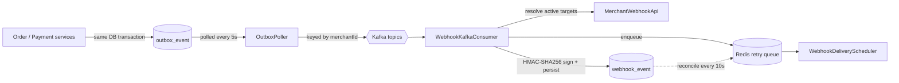

# Razorpay Clone

A payment gateway backend modeled on Razorpay's core flows — merchant onboarding, order and payment lifecycle management, card tokenization through an isolated vault, event-driven webhooks, and settlements. Built around domain-driven modeling and event-driven patterns (transactional outbox, Kafka, dead-letter handling), with a target architecture of independently deployable microservices.

## Table of Contents

- [Highlights](#highlights)
- [Overview](#overview)
- [Architecture](#architecture)
- [Design Patterns](#design-patterns)
- [Tech Stack](#tech-stack)
- [API Overview](#api-overview)
- [Project Structure](#project-structure)
- [Getting Started](#getting-started)
- [Development Status](#development-status)
- [Development Log](#development-log)

## Highlights

- **Two authentication models** — JWT for merchant dashboard routes, HTTP Basic API key authentication (key ID + secret, Redis-cached) for server-to-server payment routes
- **Payment lifecycle engine** — Strategy/Adapter routing per payment method and a transition-table state machine with a full audit log of every status change
- **PCI-conscious vault** — card numbers encrypted with envelope encryption (AES-GCM, per-card data key wrapped by a master key); CVV is validated but never stored
- **Transactional outbox + Kafka** — order and payment events are written in the same database transaction as the state change, then published to Kafka by a poller
- **Merchant webhooks** — per-merchant endpoints with event-type subscriptions, HMAC-SHA256 signed payloads, and a Redis-backed retry queue
- **Production-style safeguards** — idempotency keys, swappable Redis rate limiters, pessimistic row locking on concurrent payment operations

## Overview

The system is designed around five domains:

| Domain | Responsibility |
|---|---|
| **Merchant** | Merchant accounts, KYC, API key issuance, dashboard users, customers, webhook configuration |
| **Payment** | Orders, payments, refunds, payment state transitions, outbox events |
| **Vault** | PCI-scoped card storage and tokenization, isolated from the rest of the system |
| **Operations** | Webhook event processing and delivery scheduling, settlements, dead-letter/event replay |
| **Common** | Shared value types, enums, encryption, rate limiting, and idempotency infrastructure |

Cross-domain references (e.g. an order's `merchantId`/`customerId`, a card token's `merchant`/`customer`) are stored as plain UUIDs rather than JPA relationships, and cross-domain calls go through interfaces (e.g. `MerchantWebhookApi`), in anticipation of the microservices split where these domains will live in separate services with separate databases.

## Architecture

Target deployment is a microservices architecture:

| Service | Responsibility |
|---|---|
| `api-gateway` | Authentication, rate limiting, request routing |
| `merchant-service` | Merchant authorization, KYC, API key management, customers, webhook configuration |
| `payment-service` | Order creation, payment processing, refunds, outbox publishing |
| `operations-service` | Webhook dispatch, settlement processing, analytics |
| `vault-service` | Isolated PCI scope; card tokenization |
| `discovery-service` | Service discovery |
| `config-service` | Centralized configuration |
| `common-lib` | Shared models and utilities |

The system is currently implemented as a single Spring Boot module — domain modeling and business logic are being built out first, with the microservices split planned once core flows are validated.

### Event flow

Order and payment services never talk to Kafka directly. They write an `OutboxEvent` row in the same transaction as the business change, and a poller publishes it afterwards, so an event is never lost or emitted for a rolled-back change.



Published event types: `ORDER_CREATED`, `ORDER_CANCELLED`, `PAYMENT_CREATED`, `PAYMENT_STATUS_CHANGED`. Each outbox event is retried up to three times before being marked `FAILED`.

**Redis** is used for API key caching, rate limiting, idempotency key storage, and the webhook retry queue. Observability is provided through **Zipkin** (distributed tracing) and **Prometheus/Grafana** (metrics).

## Design Patterns

| Pattern | Where | Purpose |
|---|---|---|
| **Strategy** | `payment.processor` (`PaymentProcessor`, `CardPaymentProcessor`, `NetBankingPaymentProcessor`, `UpiPaymentProcessor`) | Per-payment-method processing logic, selected at runtime via `PaymentProcessorRouter` |
| **Adapter** | `payment.gateway` (`PaymentAdapter`, `CardPaymentAdapter`, `NetBankingAdapter`, `UpiPaymentAdapter`) | Wraps gateway-specific initiate/capture logic behind a common interface, routed via `PaymentGatewayRouter` |
| **State Machine** | `payment.statemachine` (`PaymentStateMachine`, `PaymentTransitionService`) | Enforces valid payment status transitions via a transition table, with each transition logged to `PaymentTransitionLog` |
| **Strategy** | `common.ratelimit` (`RateLimiter` with `FixedWindowRateLimiter`, `SlidingWindowRateLimiter`, `SlidingWindowLuaLimiter`, `TokenBucketRateLimiter`) | Swappable rate-limiting algorithms selected via the `app.rate-limit.method` property |
| **Transactional Outbox** | `payment.outbox` (`OutboxEventPublisher`, `OutboxPoller`, `OutboxResultHandler`) | Atomically couples a state change with its event, then publishes to Kafka with retry accounting |
| **Ports and Adapters** | `merchant.api.MerchantWebhookApi` | Lets the operations domain read webhook targets without depending on merchant internals |

## Tech Stack

- **Language:** Java 25
- **Framework:** Spring Boot 4.1.1, Spring Data JPA, Spring Security
- **Database:** PostgreSQL
- **Messaging:** Apache Kafka
- **Cache / Rate Limiting / Idempotency / Retry queue:** Redis
- **Mapping:** MapStruct
- **Auth:** JWT (jjwt), API key authentication
- **Build Tool:** Maven
- **Local Infrastructure:** Docker Compose (PostgreSQL, Redis, Kafka, Confluent Control Center)
- **Planned:** Zipkin, Prometheus/Grafana

## API Overview

| Method | Path | Auth | Description |
|---|---|---|---|
| `POST` | `/v1/auth/signup` | Public | Register a merchant and owner user |
| `POST` | `/v1/auth/login` | Public | Authenticate and receive a JWT |
| `POST` / `GET` | `/v1/merchants/api-keys` | JWT | Issue / list API keys |
| `DELETE` | `/v1/merchants/api-keys/{keyId}` | JWT | Revoke an API key |
| `POST` | `/v1/merchants/api-keys/{keyId}/rotate` | JWT | Rotate a key secret (24-hour grace period for the previous secret) |
| `POST` / `GET` | `/v1/merchants/webhooks` | JWT | Create / list webhook endpoints (signing secret is returned once, on creation) |
| `GET` / `PUT` / `DELETE` | `/v1/merchants/webhooks/{id}` | JWT | Read / update / delete a webhook endpoint |
| `POST` | `/v1/orders` | API key | Create an order |
| `POST` | `/v1/payments` | API key | Initiate a payment against an order |
| `POST` | `/v1/payments/{paymentId}/capture` | API key | Capture an authorized payment |
| `POST` | `/v1/vault/tokenize` | API key | Tokenize a card |

API key requests use HTTP Basic authentication with the key ID as username and the key secret as password. Write requests (`POST`, `PUT`, `PATCH`) accept an `X-Idempotency-Key` header; a repeated key replays the original response.

## Project Structure

```
src/main/java/com/ankitgupta/razorpay/
├── common/
│   ├── entity/         # Shared value types (Money, BaseEntity)
│   ├── enums/          # Shared enums (statuses, actors, events, roles, outbox status, aggregate types)
│   ├── config/         # AesEncryptionConfig (master-key encryptor), KafkaProperties
│   ├── dto/            # Cross-domain DTOs (WebhookTarget)
│   ├── exception/      # GlobalExceptionHandler, custom exceptions, ErrorResponse
│   ├── util/           # RandomizerUtil, SignerUtil (HMAC-SHA256)
│   ├── audit/          # AuditorAwareImpl
│   ├── ratelimit/      # RateLimiter strategies (fixed, sliding, sliding-lua, token bucket)
│   └── idempotency/    # IdempotencyFilter, IdempotencyStore, RedisIdempotencyStoreStore
├── merchant/
│   ├── entity/         # Merchant, ApiKey, AppUser, Customer, MerchantWebhookConfig
│   ├── controller/     # AuthController, ApiKeyController, WebhookConfigController
│   ├── service/        # AuthService, ApiKeyService, CustomerService, WebhookConfigService (+ impl)
│   ├── api/            # MerchantWebhookApi (cross-domain contract)
│   ├── repository/     # MerchantRepository, ApiKeyRepository, AppUserRepository, CustomerRepository, WebhookConfigRepository
│   ├── cache/          # RedisApiKeyCache
│   ├── mapper/         # MerchantMapper, ApiKeyMapper, WebhookConfigMapper
│   ├── security/       # JwtUtil, WebSecurityConfig, MerchantUserDetailsService, MerchantContext, JwtAuthenticationFilter, ApiKeyAuthenticationFilter
│   └── dto/            # request/response DTOs
├── payment/
│   ├── entity/         # OrderRecord, Payment, Refund, PaymentTransitionLog, OutboxEvent
│   ├── controller/     # OrderController, PaymentController
│   ├── service/        # OrderService, PaymentService (+ impl)
│   ├── repository/     # OrderRepository, PaymentRepository, PaymentTransitionLogRepository, OutboxEventRepository
│   ├── mapper/         # OrderMapper, PaymentMapper
│   ├── gateway/        # PaymentAdapter + per-method adapters (Card, NetBanking, UPI)
│   ├── processor/      # PaymentProcessor + per-method strategies (Card, NetBanking, UPI)
│   ├── statemachine/   # PaymentStateMachine, PaymentTransitionService
│   ├── outbox/         # OutboxEventPublisher, OutboxPoller, OutboxResultHandler
│   ├── simulator/      # BankCallbackSimulator, SimulatorConfig
│   ├── config/         # PaymentAdapterConfig, PaymentProcessorConfig
│   └── dto/            # request/response DTOs
├── vault/
│   ├── entity/         # VaultCard, CardToken (linked to customer/merchant via UUID)
│   ├── controller/     # VaultController
│   ├── service/        # VaultService (+ impl)
│   ├── repository/     # VaultCardRepository, CardTokenRepository
│   ├── config/         # VaultEncryptionConfig
│   ├── validation/     # ExpiryYear custom validator
│   └── dto/            # request/response DTOs
└── operations/
    ├── entity/         # WebhookEvent, Settlement, SettlementPayment, DlqEvent
    ├── repository/     # WebhookEventRepository
    └── webhook/        # WebhookKafkaConsumer, WebhookRetryQueue, WebhookDeliveryScheduler
```

## Getting Started

### Prerequisites

- Java 25
- Docker (for local PostgreSQL, Redis, and Kafka)
- Maven (or use the included `mvnw` wrapper)

### Installation

```bash
git clone https://github.com/Ankitsalvgupta/razorpay-clone.git
cd razorpay-clone
cp src/main/resources/application.yaml.example src/main/resources/application.yaml
```

### Start local infrastructure

```bash
docker compose -f services.docker-compose.yaml up -d
```

This starts PostgreSQL, Redis, Kafka (KRaft mode), and Confluent Control Center. Kafka is reachable from the host at `localhost:29092`, so point `spring.kafka.bootstrap-servers` there. Control Center is available at `http://localhost:9021`.

### Configuration

Set the following environment variables:

| Variable | Description |
|---|---|
| `DB_URL` | JDBC URL, e.g. `jdbc:postgresql://localhost:5432/razorpay-db` |
| `DB_USERNAME` | PostgreSQL username |
| `DB_PASSWORD` | PostgreSQL password |
| `REDIS_HOST` / `REDIS_PORT` / `REDIS_PASSWORD` | Redis connection (defaults: `localhost`, `6379`, empty) |
| `MASTER_KEY` | Base64-encoded 32-byte AES-256 master key; generate with `openssl rand -base64 32` |
| `SECRET_KEY` | HMAC secret used to sign JWTs (at least 32 characters) |

Kafka topic names are configured under `app.kafka.topics`, and the active rate limiter under `app.rate-limit.method` (`fixed`, `sliding`, `sliding-lua`, or `bucket`).

### Run

```bash
./mvnw spring-boot:run
```

## Development Status

**Completed**
- JPA entity layer modeled across all five domains (Merchant, Payment, Vault, Operations, Common)
- Merchant signup and login flow (`AuthController`, `AuthService`), password hashing via `BCryptPasswordEncoder`
- JWT authentication and API key authentication, each with its own Spring Security filter chain
- API key lifecycle: issuance, listing, revocation, rotation, Redis-backed caching (`ApiKeyController`, `ApiKeyService`)
- Customer find-or-create flow (`CustomerService`), linked to orders and vault card tokens
- Order creation flow (`OrderController`, `OrderService`)
- Payment initiation and capture flow (`PaymentController`, `PaymentService`), with pessimistic row locking on order/payment lookups to prevent concurrent-request races
- Payment routing via Strategy/Adapter pattern across Card, NetBanking, and UPI methods
- Payment state machine for status transitions, with transition logging
- Bank callback authorization resolution (`resolveAuthorization`), completing the async payment confirmation flow
- Vault card tokenization with envelope encryption (AES-GCM, DEK/KEK key hierarchy), tokens linked to customer and merchant
- Bank callback simulator for asynchronous payment status polling
- Swappable rate limiting (fixed window, sliding window, sliding window via Lua, token bucket via Lua), selected via config
- Redis-backed idempotency handling for POST/PUT/PATCH requests, scoped per merchant
- Transactional outbox with Kafka publishing for order and payment events, including retry accounting
- Merchant webhook configuration (CRUD, event-type subscriptions, signing secrets encrypted at rest)
- Webhook event pipeline: Kafka consumption, per-merchant target resolution, HMAC-SHA256 signing, persisted `WebhookEvent`, and a Redis-backed retry queue with database reconciliation
- Docker Compose setup for local PostgreSQL, Redis, and Kafka
- Repository layer for Merchant, ApiKey, AppUser, Customer, WebhookConfig, Order, Payment, PaymentTransitionLog, OutboxEvent, WebhookEvent, VaultCard, CardToken
- Global exception handling (`GlobalExceptionHandler`, custom exceptions, error response format)
- Request validation via `spring-boot-starter-validation`, including a custom `@ExpiryYear` validator
- Entity auditing (`BaseEntity` with `createdAt`/`updatedAt`, `@EnableJpaAuditing`, `AuditorAwareImpl`)
- MapStruct mappers for Merchant, ApiKey, WebhookConfig, Order, Payment DTO conversion

## Development Log

### 2026-10-24
- Added the transactional outbox: `OutboxEvent` entity, `OutboxEventPublisher`, `OutboxPoller` (publishes to Kafka keyed by merchant ID), `OutboxResultHandler` (marks events `FAILED` after three attempts), `OutboxEventRepository`, `OutboxStatus`, `EventAggregateType`
- Order and payment services now emit `ORDER_CREATED`, `ORDER_CANCELLED`, `PAYMENT_CREATED`, and `PAYMENT_STATUS_CHANGED` events inside the same transaction as the state change
- Added `KafkaProperties` for per-aggregate topic configuration and the `spring-boot-starter-kafka` dependency
- Added merchant webhook configuration: `WebhookConfigController` (CRUD at `/v1/merchants/webhooks`), `WebhookConfigService`, `WebhookConfigMapper`, `WebhookConfigRepository`, and event-type subscription matching on `MerchantWebhookConfig`
- Webhook signing secrets are generated server-side, returned once on creation, and stored AES-GCM encrypted
- Added `MerchantWebhookApi` so the operations domain can resolve active webhook targets without depending on merchant internals
- Added the webhook event pipeline: `WebhookKafkaConsumer`, `SignerUtil` (HMAC-SHA256), `WebhookEvent` persistence, `WebhookRetryQueue` (Redis sorted set), and `WebhookDeliveryScheduler` with periodic database reconciliation
- Extracted the master-key `BytesEncryptor` into `AesEncryptionConfig` in `common`, shared by the vault and webhook configuration
- Renamed `SingleWindowRateLimiter` to `SlidingWindowRateLimiter`
- Namespaced API key cache entries under the `apikey:` prefix
- Added `services.docker-compose.yaml` for local PostgreSQL, Redis, Kafka, and Confluent Control Center

### 2026-09-06
- Added customer find-or-create flow: `Customer` entity, `CustomerRepository`, `CustomerService`/`CustomerServiceImpl`
- Linked customers to orders (`OrderRecord.customerId`, via `CreateOrderRequest.customer`) and vault card tokens (`CardToken.customer`)
- Added pessimistic row locking on order and payment lookups (`findByIdAndMerchantIdForUpdate`, `findByIdForUpdate`) to prevent concurrent-request races during payment initiation, capture, and authorization
- Added `PaymentServiceImpl.resolveAuthorization()` to handle bank callback authorization outcomes, including auto-capture on approval

### 2026-09-05
- Added idempotency handling: `IdempotencyFilter`, `IdempotencyStore` interface, `RedisIdempotencyStoreStore`, `IdempotencyConflictException`
- Added three additional rate limiting strategies: sliding window, `SlidingWindowLuaLimiter` (atomic, Lua-based), `TokenBucketRateLimiter` (atomic, Lua-based)
- Wired `ApiKeyAuthenticationFilter` into a dedicated `apiKeyChain` Spring Security filter chain, scoped to `API_KEY_ROUTES`
- Ordered `IdempotencyFilter` to run after authentication in both the JWT and API key filter chains

### 2026-09-04
- Added Redis-backed API key caching and rate limiting

### 2026-09-03
- Added merchant login flow: `AuthController` login endpoint, `LoginRequest`/`LoginResponse` DTOs
- Added JWT support: `JwtUtil` for token generation/verification (jjwt)
- Added Spring Security scaffold: `WebSecurityConfig`, `MerchantUserDetailsService`, `AppUser` implementing `UserDetails`
- Added `spring-boot-starter-security` and `jjwt` dependencies
- Fixed `PaymentTransitionService.apply()` `fromStatus` ordering bug
- Fixed `PaymentProcessorConfig` to use constructor-injected Spring beans instead of manual instantiation
- Fixed `SimulatorConfig` missing `@Getter`/`@Setter` for configuration property binding

### 2026-09-02
- Implemented payment initiation and capture flow: `PaymentController`, `PaymentService`/`PaymentServiceImpl`
- Added Strategy pattern for payment processing: `PaymentProcessor` interface with `CardPaymentProcessor`, `NetBankingPaymentProcessor`, `UpiPaymentProcessor`, routed via `PaymentProcessorRouter`
- Added Adapter pattern for gateway integration: `PaymentAdapter` interface with `CardPaymentAdapter`, `NetBankingAdapter`, `UpiPaymentAdapter`, routed via `PaymentGatewayRouter`
- Added payment state machine: `PaymentStateMachine`, `PaymentTransitionService`, `InvalidStateTransitionException`
- Added vault card tokenization: `VaultController`, `VaultService`/`VaultServiceImpl`, envelope encryption via `VaultEncryptionConfig`
- Added bank callback simulator: `BankCallbackSimulator`, `SimulatorConfig`
- Added `PaymentTransitionLogRepository`, `VaultCardRepository`, `CardTokenRepository`
- Added `PaymentAdapterConfig`, `PaymentProcessorConfig` for bean wiring

### 2026-09-01
- Added JPA auditing: `BaseEntity` with `@CreatedDate`/`@LastModifiedDate`, wired into entities via `@EnableJpaAuditing`
- Added MapStruct dependency and mappers: `MerchantMapper`, `ApiKeyMapper`, `OrderMapper`, `PaymentMapper`
- Added `BusinessRuleViolationException` for business-rule-level errors
- Added `PaymentResponse` DTO
- Refactored service layer to use mappers instead of manual DTO construction
- Fixed MapStruct core/processor version mismatch in `pom.xml`
- Fixed `SettlementPaymentId`/`SettlementPayment` auditing placement (moved `BaseEntity` inheritance to the entity, off the embedded ID)
- Fixed `MerchantMapper` field mapping for `status` → `merchantStatus`
- Added database indexes across entities: `ApiKey`, `Merchant`, `AppUser`, `Customer`, `MerchantWebhookConfig`, `Payment`, `OrderRecord`, `PaymentTransitionLog`

### 2026-08-31
- Added API key management: list keys by merchant, revoke key, rotate key (with grace period on the previous secret)
- Implemented order creation flow: `OrderController`, `OrderService`/`OrderServiceImpl`, duplicate-receipt detection, configurable order expiry
- Added `RandomizerUtil` for key/secret generation
- Added `jackson-databind` dependency
- Refactored `Money` to use Lombok annotations instead of manual boilerplate

### 2026-08-30
- Implemented merchant signup flow: `AuthController`, `AuthService`/`AuthServiceImpl`, `MerchantSignupRequest`/`MerchantResponse` DTOs
- Implemented API key issuance flow: `ApiKeyController`, `ApiKeyService`/`ApiKeyServiceImpl`, `CreateApiKeyRequest`/`ApiKeyCreateResponse` DTOs
- Added repository layer: `MerchantRepository`, `ApiKeyRepository`, `AppUserRepository`
- Added global exception handling: `GlobalExceptionHandler`, `ResourceNotFoundException`, `DuplicateResourceException`, `ErrorResponse`
- Added `spring-boot-starter-validation` dependency for request validation

### 2026-08-27
- Modeled full entity relationship schema and JPA entities across merchant, payment, vault, and operations domains
- Initialized project with Spring Boot 4.1.1, Java 25, Spring Data JPA, PostgreSQL, Lombok
